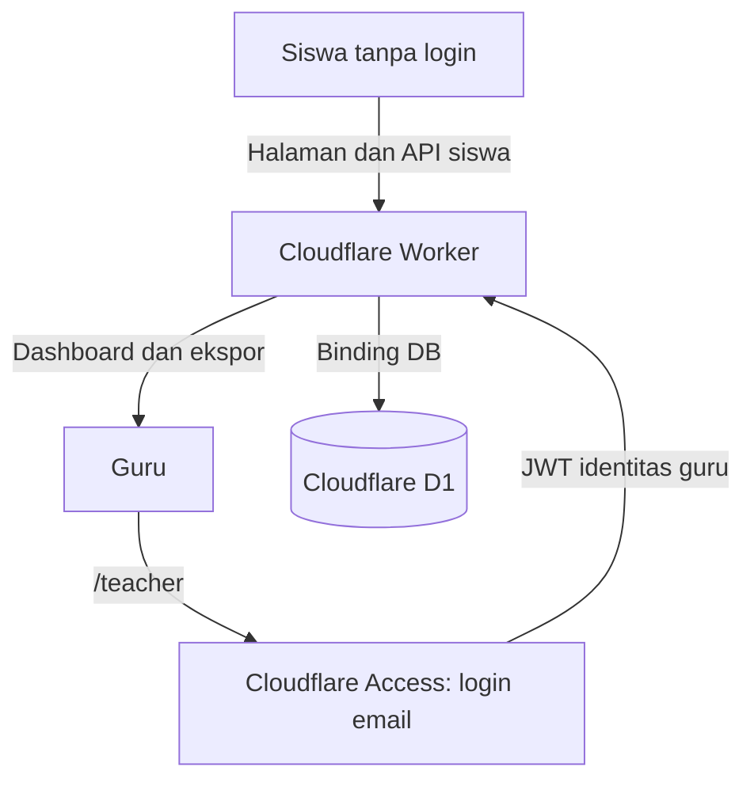

# Alur deployment enviedu ke Cloudflare Workers

Panduan ini memakai akun Cloudflare sendiri, Cloudflare Workers untuk aplikasi,
D1 untuk data, dan Cloudflare Access untuk login satu guru. Siswa tetap membuka
aplikasi tanpa akun.

Source publik ini menyediakan template Wrangler dan dukungan Cloudflare Access.
Isi konfigurasi akun, database, team domain, audience, dan email guru pada
lingkungan deployment sendiri. Identitas deployment produksi dan token tidak
disertakan dalam repository.

## Pembagian pekerjaan

| Pekerjaan | Siapa yang mengerjakan |
| --- | --- |
| Ubah kode, siapkan konfigurasi, jalankan tes dan dry run | Codex; tidak memerlukan akun Cloudflare. |
| Daftar akun, verifikasi email, login browser, dan isi OTP | Pemilik akun. |
| Pilih akun Cloudflare, domain, email guru, serta paket layanan | Pemilik akun; Codex dapat membantu menyiapkan pilihan teknis. |
| Buat D1, terapkan migrasi, isi konfigurasi, dan deploy melalui Wrangler | Codex dapat menjalankan setelah akun terautentikasi dan targetnya jelas. |
| Atur aplikasi/policy Access dan DNS | Codex dapat mengotomasi bila ada akses API yang sesuai; tanpa akses tersebut, pemilik akun mengikuti langkah dashboard di panduan ini. |
| Uji login guru dengan PIN email | Pemilik email, bersama pemeriksaan aplikasi oleh Codex. |

Jika belum punya akun, mulai dari pendaftaran di
[Cloudflare](https://dash.cloudflare.com/sign-up). Jangan kirim password, OTP,
atau API token ke chat. `wrangler login` memberi akses lewat alur browser.

## 1. Tentukan arsitektur dan alamat aplikasi



Worker menyajikan frontend React sekaligus API. Build yang tersedia sudah
menggabungkan frontend ke `build/cloudflare/server/index.js`. D1 menyimpan jawaban, progres,
pemetaan kondisi per sesi, dan penghitung permintaan. Aplikasi saat ini tidak memerlukan
R2 karena belum memiliki fitur unggah berkas.

Alamat deployment adalah `https://enviedu.com`. Zona domain aktif dan sudah
terhubung ke Worker pada akun pemilik. Halaman siswa dan dashboard guru berada
pada origin yang sama.
[Dokumentasi Custom Domains](https://developers.cloudflare.com/workers/configuration/routing/custom-domains/).

Jika belum memiliki domain, dapat mulai dengan alamat `workers.dev` bawaan akun.
Pada konfigurasi, hapus `routes`, ubah `workers_dev` menjadi `true`, lalu gunakan
hostname Worker tersebut pada semua path Access di langkah 5. Perlindungan
berdasarkan hostname/path tetap diperlukan agar siswa tidak diminta login.
[Access pada hostname Workers](https://developers.cloudflare.com/workers/configuration/cloudflare-access/).

## 2. Pastikan aplikasi berjalan secara lokal

Gunakan Node.js 24 atau lebih baru. Jalankan dari PowerShell:

```powershell
cd D:\Research\Environmental-Learning\enviedu
$env:PATH = 'C:\Program Files\nodejs;C:\Program Files\Git\cmd;' + $env:PATH
npm.cmd ci
npm.cmd run check
npm.cmd test
npm.cmd run build
npm.cmd run dev
```

Buka `http://127.0.0.1:4173` untuk siswa dan `/teacher` untuk guru. Hentikan server
dengan Ctrl+C sebelum melanjutkan. Login lokal yang disimulasikan hanya untuk
adapter Node pada loopback; fitur tersebut bukan login untuk Worker publik.

## 3. Pasang Wrangler dan masuk ke akun Cloudflare

Wrangler adalah CLI untuk mengelola Worker dan D1:

```powershell
$env:XDG_CONFIG_HOME = Join-Path (Get-Location) '.artifacts/cloudflare-config'
$env:WRANGLER_LOG_PATH = Join-Path (Get-Location) '.artifacts/wrangler-logs'
$env:WRANGLER_SEND_METRICS = 'false'
npx.cmd wrangler login
npx.cmd wrangler whoami
```

Jalankan dari direktori `enviedu`. Autentikasi sesi ini disimpan di direktori
konfigurasi proyek yang diabaikan Git; gunakan pengaturan environment di atas
juga pada terminal baru agar Wrangler menemukan login yang sama.
Wrangler sudah menjadi dependensi proyek dan terpasang lewat `npm ci` pada
langkah 2. Selesaikan login melalui browser dan periksa akun yang dipilih.
[Dokumentasi Wrangler](https://developers.cloudflare.com/workers/wrangler/install-and-update/).

## 4. Buat database dan konfigurasi Worker

```powershell
npx.cmd wrangler d1 create enviedu-db
```

Salin `database_id` dari hasil perintah. Jika Wrangler menawarkan penambahan
binding otomatis, periksa hasilnya lalu sesuaikan dengan konfigurasi berikut.
Nama binding harus **DB**, sesuai `env.DB` pada kode aplikasi.
[Dokumentasi pembuatan dan binding D1](https://developers.cloudflare.com/d1/get-started/).

Konfigurasi akun lokal `wrangler.jsonc` sudah dibuat untuk deployment ini. Untuk
checkout baru yang belum memiliki berkas tersebut, salin template (jalankan dari
`enviedu`) lalu isi nilai akun:

```powershell
Copy-Item -LiteralPath wrangler.example.jsonc -Destination wrangler.jsonc
```

Ganti domain, database ID, team domain, dan AUD dengan nilai akun sendiri. Team
domain dan AUD diperoleh pada langkah 5; keduanya konfigurasi, bukan password.

`wrangler.jsonc` diabaikan Git agar konfigurasi akun tetap lokal. Template yang
disimpan di repo adalah [`wrangler.example.jsonc`](../wrangler.example.jsonc).
Jangan deploy nilai contoh; UUID nol bukan database produksi.

`main` menunjuk ke hasil build karena entry sumber `worker/cloudflare.ts` mengimpor
modul virtual `enviedu:assets` yang dibuat oleh build proyek. `no_bundle` memakai
hasil bundle tersebut langsung. Tidak perlu konfigurasi `assets.directory` untuk
arsitektur saat ini. `workers_dev` dan `preview_urls` dinonaktifkan dalam contoh
agar alamat yang digunakan hanya domain yang dikonfigurasi.
[Referensi konfigurasi Wrangler](https://developers.cloudflare.com/workers/wrangler/configuration/).

`npm run build` membuat paket Sites. **`npm run build:cloudflare` membuat paket
Workers mandiri**, sesuai perintah build pada template Wrangler. Build mandiri
menulis ke `build/cloudflare/server/index.js`; paket Sites tetap di
`dist/server/index.js`. Deploy Wrangler selalu menjalankan build Cloudflare.
Build Cloudflare tidak membaca atau menyertakan manifest `.openai/hosting.json`.
Manifest Sites tetap digunakan hanya untuk build Sites.

## 5. Siapkan Cloudflare Access untuk guru

Status deployment saat ini: proteksi Access untuk halaman dan API guru sudah
aktif, dengan team domain dan AUD yang cocok pada konfigurasi Worker produksi.
Daftar aplikasi melalui OAuth Wrangler tidak menampilkan aplikasi ini; AUD
diambil dari pengalihan login HTTPS yang konsisten pada semua rute guru.
Pembuatan aplikasi melalui izin Wrangler ditolak dengan HTTP 403, sehingga
pengelolaan aplikasi/policy dilakukan melalui dashboard. Langkah berikut menjadi
referensi bila konfigurasi Access perlu dibuat ulang.

1. Buka Cloudflare Zero Trust dan selesaikan setup organisasi. Catat team domain.
2. Aktifkan metode login **One-time PIN** untuk menerima kode melalui email.
3. Di **Access controls > Applications**, buat aplikasi **Self-hosted and private**.
   Gunakan nama **enviedu-teacher** agar mudah dikenali.
4. Masukkan empat hostname/path berikut dalam **aplikasi Access yang sama**:

   ```text
   enviedu.com/teacher
   enviedu.com/teacher/*
   enviedu.com/api/teacher
   enviedu.com/api/teacher/*
   ```

5. Buat kebijakan **Allow**, dengan **Include > Emails** berisi alamat email satu
   guru. Pilih One-time PIN sebagai metode login aplikasi.
6. Salin **Application Audience (AUD)** ke `CF_ACCESS_AUD` di `wrangler.jsonc`.
   Isi `CF_ACCESS_TEAM_DOMAIN` dengan URL team domain, tanpa slash di akhir.

Dengan cakupan path tersebut, halaman `/`, aset `/assets/...`, dan API
`/api/student/...` tetap dapat digunakan siswa tanpa login. Hindari menerapkan
Access ke seluruh Worker karena itu juga akan meminta siswa untuk masuk.
Memakai satu aplikasi Access memberi dashboard dan API guru audience yang sama.
[Access untuk path Worker](https://developers.cloudflare.com/workers/configuration/cloudflare-access/),
[pengaturan path](https://developers.cloudflare.com/cloudflare-one/access-controls/policies/app-paths/),
dan [login One-time PIN](https://developers.cloudflare.com/cloudflare-one/integrations/identity-providers/one-time-pin/).

### Tampilkan hanya login dengan kode email

Cloudflare menjadi identity provider bawaan pada organisasi Zero Trust baru.
Jika halaman login menampilkan tombol **Cloudflare** dan formulir **Send login
code**, pilih metode login per aplikasi:

1. Buka **Access controls > Applications > enviedu-teacher > Configure**.
2. Cari **Login methods** pada pengaturan autentikasi aplikasi.
3. Matikan **Accept all available identity providers**, jika aktif.
4. Pilih hanya **One-time PIN** dan hilangkan pilihan **Cloudflare**.
5. Simpan, lalu periksa `/teacher` melalui jendela privat tanpa sesi login.

Policy email guru tetap menggunakan alamat guru yang dikonfigurasi. Perubahan
ini dilakukan pada aplikasi Access; tidak memerlukan perubahan kode atau deploy
Worker. Halaman PIN tetap dilayani Cloudflare Access.
[Dokumentasi identity provider Cloudflare](https://developers.cloudflare.com/cloudflare-one/integrations/identity-providers/cloudflare/).

## 6. Kenali autentikasi yang sudah disiapkan

Jalur mandiri sudah memverifikasi JWT Access sebelum API menerima identitas.
`server/api.ts` menerima identitas melalui parameter internal dan tidak membaca
header identitas dari permintaan. Header Sites yang dikirim pemanggil langsung
ke Worker mandiri tidak memberikan akses guru.

| Berkas | Peran |
| --- | --- |
| `worker/cloudflare.ts` | Entry mandiri; tidak memakai header login Sites. |
| `server/cloudflare-handler.ts` | Memverifikasi autentikasi untuk setiap permintaan API guru sebelum memanggil API bersama. |
| `server/cloudflare-auth.ts` | Memverifikasi signature, issuer, audience, masa berlaku, serta klaim identitas dengan `jose` dan cache JWKS. |
| `server/api.ts` | Mencocokkan email yang sudah diverifikasi dengan `TEACHER_EMAIL`; konfigurasi atau identitas tidak valid ditolak. |
| `src/TeacherApp.tsx` dan `src/teacherRequests.ts` | Memakai URL login/logout dari server, mengirim header AJAX, dan menangani respons login yang bukan JSON. |
| `worker/index.ts` | Entry khusus Sites; menerima identitas dari gateway Sites. Tidak digunakan template Wrangler mandiri. |
| `scripts/dev-server.mjs` | Adapter loopback dengan simulasi guru untuk pengembangan lokal. Tidak disertakan pada paket Worker. |

Pustaka `jose` sudah menjadi dependensi proyek. Alur backend:

```text
Request API guru
  -> ambil Cf-Access-Jwt-Assertion
  -> verifikasi signature dengan JWKS dari team domain yang dikonfigurasi
  -> periksa issuer, audience aplikasi, dan masa berlaku
  -> ambil sub dan email dari payload yang sudah diverifikasi
  -> cocokkan email dengan TEACHER_EMAIL
  -> izinkan baca data kedua kelas atau ekspor
```

Endpoint JWKS adalah
`https://team-anda.cloudflareaccess.com/cdn-cgi/access/certs`. Gunakan URL dari
konfigurasi server, bukan dari isi token. Gunakan kembali cache JWKS antarrequest.
Header email Access atau hasil decode JWT tanpa verifikasi tidak membuktikan
identitas. Jalur Workers mandiri tidak mempercayai header Sites.
[Contoh resmi verifikasi JWT](https://developers.cloudflare.com/cloudflare-one/access-controls/applications/http-apps/authorization-cookie/validating-json/).

Permintaan API guru sudah memakai `X-Requested-With: XMLHttpRequest` agar
Access dapat mengembalikan 401 saat sesi habis, lalu tangani status tersebut di
frontend. `credentials: 'same-origin'` mengirim cookie login.
Logout menggunakan endpoint Access, yang mengakhiri sesi Access pengguna lintas
aplikasi. [Dokumentasi sesi, AJAX, dan logout](https://developers.cloudflare.com/cloudflare-one/access-controls/access-settings/session-management/).

`tests/cloudflare.test.mjs` memeriksa token hilang/palsu/kedaluwarsa, issuer dan
audience salah, klaim yang hilang, email berbeda, serta API siswa tanpa login.
Tes lokal memakai kunci uji. Login dengan aplikasi Access dan pengambilan JWKS
produksi tetap perlu diperiksa setelah akun dan deployment tersedia.

## 7. Terapkan skema database

Migrasi yang tersedia ada pada `drizzle/0000_abnormal_medusa.sql`. Wrangler akan
membacanya karena `migrations_dir` sudah menunjuk ke `drizzle`:

```powershell
npx.cmd wrangler d1 migrations apply enviedu-db --local
npx.cmd wrangler d1 migrations apply enviedu-db --remote
npx.cmd wrangler d1 migrations list enviedu-db --remote
```

`--local` menyiapkan database lokal Wrangler; `--remote` menyiapkan database
Cloudflare yang akan dipakai siswa. Database lokal Wrangler, SQLite milik
`npm run dev`, dan database produksi adalah database terpisah.
[Dokumentasi migrasi D1](https://developers.cloudflare.com/d1/reference/migrations/).

Database baru berawal kosong. Data dari deployment Sites atau SQLite lokal tidak
berpindah otomatis. Untuk berpindah dari situs lama, tentukan apakah memakai
pengumpulan baru atau memigrasikan data secara terpisah sebelum mengganti tautan
untuk siswa. Browser juga menyimpan progres menurut origin; siswa yang sedang
mengerjakan sebaiknya menyelesaikan sesi pada alamat lama.

## 8. Verifikasi build dan konfigurasi email guru

Paket dapat diperiksa tanpa akun menggunakan template:

```powershell
npm.cmd run check
npm.cmd test
npm.cmd run cf:dry-run
```

Setelah `wrangler.jsonc` berisi konfigurasi akun yang sebenarnya, periksa kembali
konfigurasi tersebut lalu simpan email guru:

```powershell
npx.cmd wrangler deploy --config wrangler.jsonc --dry-run
npx.cmd wrangler secret put TEACHER_EMAIL
```

Dry run membangun dan memeriksa paket tanpa memublikasikan Worker. Perintah
`secret put` menyimpan konfigurasi ke Cloudflare: masukkan email yang sama dengan
Allow policy Access. Pada proyek baru, Wrangler dapat meminta membuat Worker
sebelum menyimpan secret. Jangan masukkan email guru ke bundle frontend atau
manifest Sites. [Dokumentasi secrets](https://developers.cloudflare.com/workers/configuration/secrets/).

Tes otomatis sudah mencakup token hilang, signature salah, issuer/audience salah,
token kedaluwarsa, email guru berbeda, serta header Sites palsu. Semuanya harus
ditolak tanpa mengembalikan data guru.

## 9. Deploy dan coba alur siswa serta guru

```powershell
npm.cmd run cf:deploy
```

Wrangler menjalankan `npm run build:cloudflare` dari konfigurasi, mengunggah
`build/cloudflare/server/index.js`, dan memasang binding D1 serta custom domain. Jika
sertifikat domain masih diproses, tunggu sampai domain aktif sebelum pengujian.

Lakukan uji coba dengan data percobaan pada dua sesi browser terpisah:

1. Siswa membuka `https://enviedu.com` tanpa diminta login.
2. Siswa memulai kegiatan dan menyimpan jawaban; status simpan harus dikonfirmasi
   server.
3. Guru membuka `https://enviedu.com/teacher`, menerima PIN melalui email,
   lalu masuk.
4. Guru melihat jawaban percobaan dari perangkat/browser lain dan mencoba ekspor
   CSV.
5. Siswa memilih kelas sesuai arahan guru: kelas A menerima guided comparison,
   kelas B menerima separate-case reflection. Setelah simulasi waste dan flood,
   kelas A membuka **Compare & generalize** (4 pertanyaan, minimum 60 detik).
   Kelas B membuka **Waste · Reflect** lalu **Flooding · Reflect** pada halaman
   terpisah (2 pertanyaan dan minimum 30 detik per kasus), tanpa pemetaan
   antarkasus. Periksa urutan sidebar dan total progres: A 10 tahap, B 11 tahap.
   Keduanya dapat berjalan bersamaan. Periksa ringkasan per kelas, filter hasil,
   dan kolom `class_id`, `stage`, serta `protocol_version` pada CSV di dashboard
   guru. Sesi collection-v4 tetap memakai alur dan versi asalnya; alur baru
   berlaku untuk sesi baru dengan protokol `pilot-draft-5-class-journeys-en`.
6. Browser tanpa login dan akun selain guru tidak dapat membaca API maupun
   mengunduh ekspor guru. Login dengan header Sites palsu juga harus gagal.
7. Setelah logout, dashboard tidak boleh mengambil data guru lagi. Uji juga
   pemulihan setelah sesi login habis.

## 10. Alur pembaruan berikutnya

Setelah mengubah kode, jalankan pemeriksaan, tes, dan dry run seperti langkah 8.
Jika skema berubah, buat migrasi baru dengan `npm.cmd run db:generate`, simpan
berkas migrasinya, lalu terapkan ke database target sebelum kode yang
membutuhkannya dipublikasikan:

```powershell
npx.cmd wrangler d1 migrations apply enviedu-db --remote
npm.cmd run cf:deploy
```

Wrangler tidak otomatis menerapkan migrasi D1 saat `deploy`. Gunakan migrasi yang
kompatibel dengan Worker yang masih berjalan selama pembaruan, dan jangan
mengubah migrasi yang sudah diterapkan. Untuk memeriksa masalah runtime:

```powershell
npx.cmd wrangler tail
```

Jangan log jawaban siswa, cookie, atau token login. Untuk backup manual D1:

```powershell
New-Item -ItemType Directory -Force .artifacts/backups
npx.cmd wrangler d1 export enviedu-db --remote --output=.artifacts/backups/enviedu-backup.sql
```

Direktori `.artifacts/` sudah diabaikan Git. Simpan salinan backup penelitian di
penyimpanan yang aksesnya dibatasi. [Dokumentasi ekspor D1](https://developers.cloudflare.com/d1/best-practices/import-export-data/).

## 11. Menghapus jawaban melalui dashboard guru

Buka `/teacher`, lalu gunakan checkbox peserta atau **Select all on this page**.
Untuk seluruh hasil lintas halaman, pilih **Select all N matching sessions**;
pilihan ini mengikuti filter pencarian, kelas, dan status. Maksimum 500 sesi
dalam satu penghapusan. Pilihan tetap tersimpan saat berpindah halaman dan
dikosongkan saat filter diubah.

Pilih **Delete selected data**, periksa jumlah serta ID peserta pada dialog,
lalu konfirmasi atau batalkan. Penghapusan menghapus seluruh sesi yang dipilih,
termasuk jawaban, skor, dan riwayat simulasi. Ringkasan serta ekspor guru
mengikuti data yang tersisa. Sesi yang masuk setelah pilihan dibuat tidak ikut
dihapus. Ekspor data terlebih dahulu jika salinannya diperlukan.

Progres lokal di perangkat siswa tetap tersimpan; bersihkan data situs pada
browser siswa bila akan mengulang sesi. ID peserta yang sudah dihapus dapat
dipakai untuk pendaftaran baru; cookie unggah sesi lama tidak berlaku untuk
sesi baru tersebut. Tidak diperlukan migrasi database atau deploy ulang
setelah guru menghapus data.

## 12. Pembersihan otomatis sesi yang tidak selesai

Sesi yang belum selesai dihapus setelah **1 jam tanpa checkpoint baru yang
berhasil disimpan**. Waktu dihitung dari `updated_at` server; peserta yang masih
aktif dapat melanjutkan lebih dari satu jam. Unggahan duplikat tidak memperpanjang
batas waktu. Sesi yang sudah selesai atau memiliki `submitted_at` tetap disimpan.

`wrangler.jsonc` dan templatenya memasang Cron Trigger `*/5 * * * *`. Handler
`scheduled` di Worker membersihkan sesi kedaluwarsa setiap lima menit meski
tidak ada kunjungan. Pengambilan data oleh guru dan pendaftaran baru juga
membersihkan sesi kedaluwarsa sebelum menghitung atau membuat data. Karena itu,
dashboard tidak menampilkan sesi lama ketika diperbarui. Tanpa kunjungan,
penghapusan fisik dapat menunggu jadwal berikutnya, hingga sekitar lima menit.
[Panduan Cron Triggers](https://developers.cloudflare.com/workers/configuration/cron-triggers/).

Jika Cloudflare menolak jadwal dengan kode `10063`, akun belum mempunyai
subdomain Workers. Siapkan subdomain Workers pada akun sendiri
untuk keperluan tersebut. Worker tetap memakai custom domain `enviedu.com`
dengan `workers_dev: false` dan `preview_urls: false`. Jadwal yang baru dipasang
dapat memerlukan hingga 15 menit untuk propagasi awal; pembersihan saat
pengambilan data guru tetap berjalan langsung dari kode Worker yang aktif.

Unggahan dari sesi kedaluwarsa mendapat HTTP 410 dan tidak membuat datanya hidup
kembali. Siswa mendapat pilihan **Start a new session**; progres lokal sesi itu
dibersihkan saat mulai ulang, dan ID peserta yang sama dapat dipakai kembali.
Gangguan jaringan biasa tetap memakai retry dan tidak dianggap kedaluwarsa.
Tidak ada migrasi skema database untuk kebijakan ini. Progres parsial yang sudah
dihapus tidak lagi tersedia di ekspor penelitian.
